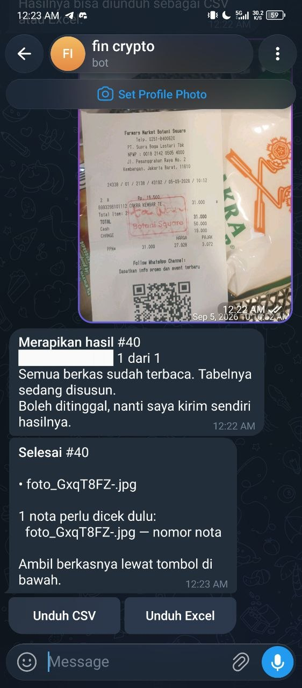

# nota.ekstrak

Bot Telegram yang mengubah foto atau PDF nota menjadi tabel, lalu mengirimnya
kembali sebagai CSV dan Excel.

Staf admin dan finance menghabiskan waktu mengetik ulang nota ke spreadsheet.
Pekerjaan itu lambat, rawan salah ketik, dan hasilnya tidak bisa dicari.
Proyek ini memindahkan bagian membosankan itu ke model bahasa yang bisa melihat
gambar, dan menyisakan bagian yang memang butuh manusia: memeriksa angka.

## Alur

```
kirim foto/PDF  →  bot antre  →  model baca  →  tabel  →  CSV/Excel
kirim link Drive publik  →  ┘
```



Setelah berkas diterima, bot langsung membalas satu pesan yang menyunting
dirinya sendiri selama pekerjaan berjalan ("Memproses 2 dari 3"), lalu
menggantinya dengan ringkasan dan tombol unduh. Satu kiriman tidak pernah
menghasilkan lebih dari satu pesan.

## Akurasi

Diukur dengan `eval/score.py` terhadap 5 nota dari dataset SROIE, model
`DeepSeek-V4.1-Flash-1017`. Angka di bawah diambil dari `eval/dataset/hasil_5.json`,
bukan perkiraan:

| kolom | benar |
|---|---|
| vendor | 5/5 |
| tanggal | 5/5 |
| total | 5/5 |
| mata_uang | 5/5 |
| nomor_nota | 1/5 |

`nomor_nota` adalah kolom terlemah dan itu diketahui. Kelima nota di dataset itu
sama sekali tidak mencetak nomor, dan model tetap mengisi 4 di antaranya —
angka yang dikarang dari digit lain di kertas, bukan dibaca. Hanya satu yang
benar, yaitu yang mengosongkan. Karena itu setiap nomor nota yang dihasilkan
selalu ditandai untuk diperiksa manusia: sistem tidak pernah mengaku yakin pada
kolom ini. Waktu proses 2,6–9,8 detik per nota, rata-rata 4,6 detik.

Angka 1/5 ini bukan tanda model buruk pada nota asli — lima kertas uji itu
memang tidak punya nomor untuk dibaca. Tapi justru itulah alasan fitur
"perlu dicek" ada: kalau nomor tidak tercetak, model akan mengarang.

## Menjalankan

Butuh Python 3.12+.

```bash
git clone <url> nota-ekstrak && cd nota-ekstrak
python -m venv .venv && . .venv/bin/activate
pip install -r requirements.txt

cp .env.example .env      # lalu isi TOKEN, SECRET, dan RIVER_API_KEY
python scripts/seed_env.py  # opsional: ambil kunci dari environment

python serve.py           # webhook dan worker dalam satu proses
```

Setelah layanan hidup, daftarkan alamat publik ke Telegram:

```bash
curl "https://api.telegram.org/bot$TELEGRAM_BOT_TOKEN/setWebhook" \
     -d "url=https://<alamat-publik-anda>/telegram/$TELEGRAM_WEBHOOK_SECRET"
```

`<alamat-publik-anda>` sengaja dikosongkan. Repo ini tidak membawa alamat
tunnel siapa pun — setiap pemasangan memakai alamatnya sendiri.

Beri izin ke chat sendiri lewat `scripts/admin_cli.py allow <chat_id>`.
Tanpa izin, bot menolak setiap pesan. Ini disengaja: mengizinkan orang harus
tindakan sadar, bukan bawaan.

## Perintah

| perintah | kegunaan |
|---|---|
| `/help` | cara pakai langkah demi langkah, bukan sekadar daftar |
| `/status` | kiriman yang berjalan dan sisa jatah hari ini |
| `/batal` | hentikan kiriman yang sedang berjalan |
| `/delete` | daftar kiriman yang bisa dihapus |
| `/delete 12` | hapus kiriman nomor 12 beserta berkas dan hasilnya |
| `/delete semua` | hapus seluruh riwayat, lalu minta konfirmasi |

`/delete` tanpa argumen menampilkan nomor kiriman yang sudah selesai. Nomor itu
yang dipakai untuk menghapus — bukan nama berkas, karena nama berkas tidak unik
dan mudah salah ketik.

Tiga hal yang dijaga di sana, masing-masing punya tes:

**Satu chat tidak bisa menghapus milik chat lain**, sekalipun nomornya benar.
Penyaringan `chat_id` ada di dalam SQL, bukan setelah data dibaca.

**Kiriman yang masih berjalan tidak bisa dihapus** di tengah jalan. Kalau boleh,
worker akan menulis ke baris yang sudah tidak ada. User diminta `/batal` dulu.

**Hapus semua butuh dua langkah:** `/delete semua` hanya menanyakan, dan baru
`/delete ya` benar-benar menghapus. Satu salah ketik tidak boleh menghabiskan
riwayat.

Yang dihapus bukan cuma baris tabel: berkas asli di `data/uploads/`, hasil tabel
di basis data, catatan pemakaian model, dan berkas CSV/Excel yang sudah dibuat.

## Alamat publik (bagian yang paling mudah bikin bingung)

Telegram mengirim pesan lewat **webhook**: Telegram yang menghubungi server
kita, bukan sebaliknya. Akibatnya server ini harus bisa dijangkau dari
internet, padahal `serve.py` hanya mendengarkan di `127.0.0.1`. Ada tiga cara
menjembatani itu, dan pilihannya menentukan seberapa repot perawatannya.

**1. Cloudflare Quick Tunnel — gratis, tanpa akun, alamat berganti.**
Cocok untuk mencoba di laptop.

```bash
cloudflared tunnel --url http://127.0.0.1:2785
```

Perintah itu mencetak alamat acak seperti
`https://kata-kata-acak.trycloudflare.com`. Tempel alamat itu ke `setWebhook`.

Masalahnya: **setiap kali cloudflared dijalankan ulang, alamatnya berubah.**
Webhook lama menunjuk ke alamat mati, Telegram menganggap pengiriman gagal, dan
bot tampak diam padahal prosesnya hidup. Gejalanya menyesatkan. Setiap kali
tunnel dinyalakan, `setWebhook` harus dijalankan lagi.

**2. ngrok — sama gratisnya, sama bergantinya** (kecuali memakai domain
berbayar). Satu akun diperlukan untuk pemakaian berulang.

**3. Domain tetap di VPS — paling tidak repot, berbayar.** Beli VPS, arahkan
domain ke sana, jalankan `serve.py` di belakang reverse proxy (Caddy atau Nginx)
yang menangani HTTPS. Alamatnya tidak pernah berubah, jadi `setWebhook` cukup
sekali. Ini yang dipakai kalau botnya untuk dipakai orang lain setiap hari.

**Saran:** pakai Quick Tunnel selama mengembangkan, pindah ke domain tetap
begitu ada orang lain yang bergantung pada bot ini. Untuk tunnel sementara,
periksa apakah webhook masih menunjuk ke tempat yang benar:

```bash
curl -s "https://api.telegram.org/bot$TELEGRAM_BOT_TOKEN/getWebhookInfo"
```

Perhatikan `url` dan `last_error_message`. Kalau `url` menunjuk ke alamat yang
sudah mati, bot tidak akan pernah menerima pesan.

`serve.py` bisa menerima `PUBLIC_URL` — kalau diisi, ia mendaftarkan ulang
webhook sendiri saat start, sehingga langkah `setWebhook` manual tidak perlu
diulang setiap kali alamat berubah.

## Struktur

```
serve.py        titik masuk: webhook + worker + pembersih
db.py           koneksi, skema, migrasi
storage/        satu modul per domain: jobs, files, receipts, chats, usage, deletes
bot/            terima pesan (handler), teks balasan (reply), HTTP Telegram
services/       unduh berkas, rasterisasi PDF, panggil model, ekspor
routes/         pintu masuk webhook, titik kesehatan
eval/           pengukuran akurasi dengan model sungguhan
tests/          165 tes
```

Ada satu aturan yang dipegang seluruh kode: **hanya `storage/` yang menulis SQL.**
Kalau route atau service butuh data, fungsinya ditambahkan di sana. Akibatnya
tes bisa memakai basis data sementara tanpa menyentuh data asli, dan satu
perubahan skema hanya perlu diikuti di satu tempat.

Handler webhook sengaja tidak memanggil model dan tidak mengunduh berkas. Ia
hanya mencatat pekerjaan lalu membalas di bawah satu detik. Semua pekerjaan
berat berjalan di worker terpisah. Tanpa pemisahan ini, Telegram akan mengulang
kiriman karena menganggap bot tidak merespons.

## Keputusan yang perlu dijelaskan

**Pesan progres disunting, bukan ditumpuk.** Telegram membatasi jumlah pesan
per detik. Pekerjaan 20 berkas bisa menghasilkan puluhan pembaruan; kalau
masing-masing jadi pesan baru, chat user penuh oleh kemajuan dan justru
hasilnya yang terlewat. Id pesan disimpan di kolom `jobs.progress_message_id`
dan disunting dengan jeda minimum.

**Worker mengabari hasilnya sendiri.** Termasuk ketika semua berkas gagal
diunduh. Awalnya kegagalan hanya tercatat di basis data dan user menunggu
selamanya — ada tes yang sekarang mengunci perilaku itu.

**Hitungan kemajuan ditetapkan, bukan ditambah.** Satu PDF bisa berisi sembilan
halaman, sementara awalnya dianggap satu berkas. Versi pertama menambah angka
di dua tempat sehingga bilahnya menampilkan "15 dari 9". Sekarang worker
menghitung ulang dari jumlah halaman yang benar-benar dibaca.

**Berkas lama dibersihkan otomatis.** Folder unggahan tumbuh setiap kiriman dan
tidak pernah menyusut sendiri. Satu thread membersihkan berkas lebih tua dari
tujuh hari setiap dua belas jam; baris basis data dihapus setelah tiga puluh
hari. Pekerjaan yang masih antre atau berjalan tidak pernah disentuh, sekalipun
umurnya sudah lewat.

## Batasan

- Maksimum 5 gambar per panggilan model. Di atas itu belum diuji.
- PDF dirasterisasi lebih dulu; model tidak menerima PDF mentah.
- Foto yang dikecilkan Telegram kehilangan detail teks. Kirim sebagai Dokumen
  untuk hasil terbaik.
- Total dan tanggal pernah salah baca pada foto beresolusi rendah. Kolom yang
  meragukan ditandai, tetapi tetap perlu diperiksa.
- Satu worker sekuensial. Kiriman banyak akan mengantre, bukan diproses paralel.

## Tes

```bash
python -m unittest discover -s tests -t .
```

165 tes, semuanya berjalan tanpa memanggil API berbayar. Model selalu dipalsukan
di tes; akurasi sesungguhnya hanya diukur lewat `eval/run_live.sh`.

## Lisensi

Kode proyek ini MIT — lihat `LICENSE`. Bebas dipakai, diubah, dan dijual,
dengan syarat notice hak cipta ikut disertakan.

Dependensi hampir semuanya permisif dan tidak menimbulkan kewajiban tambahan:
Flask, Werkzeug, Jinja2, MarkupSafe, itsdangerous, click (BSD-3-Clause),
blinker, openpyxl, et-xmlfile (MIT), Pillow (MIT-CMU).

**Satu pengecualian yang perlu dibaca sebelum dipakai komersial:** PyMuPDF
berlisensi ganda — **AGPL-3.0** atau lisensi komersial Artifex. AGPL lebih
ketat daripada MIT: kalau layanan ini diakses lewat jaringan, kode sumbernya
harus tersedia bagi pengguna layanan, termasuk perubahan yang dibuat.

Karena itu, memakai proyek ini apa adanya untuk penggunaan pribadi atau
internal tidak masalah. Untuk menjalankannya sebagai layanan publik atau
komersial, pilih salah satu: bayar lisensi komersial Artifex, atau ganti
PyMuPDF dengan pustaka berlisensi permisif seperti `pypdf` (khusus ambil teks)
atau `pypdfium2` (render halaman ke gambar, BSD/Apache).

MIT pada `LICENSE` hanya mengikat kode di repo ini, bukan dependensinya.

